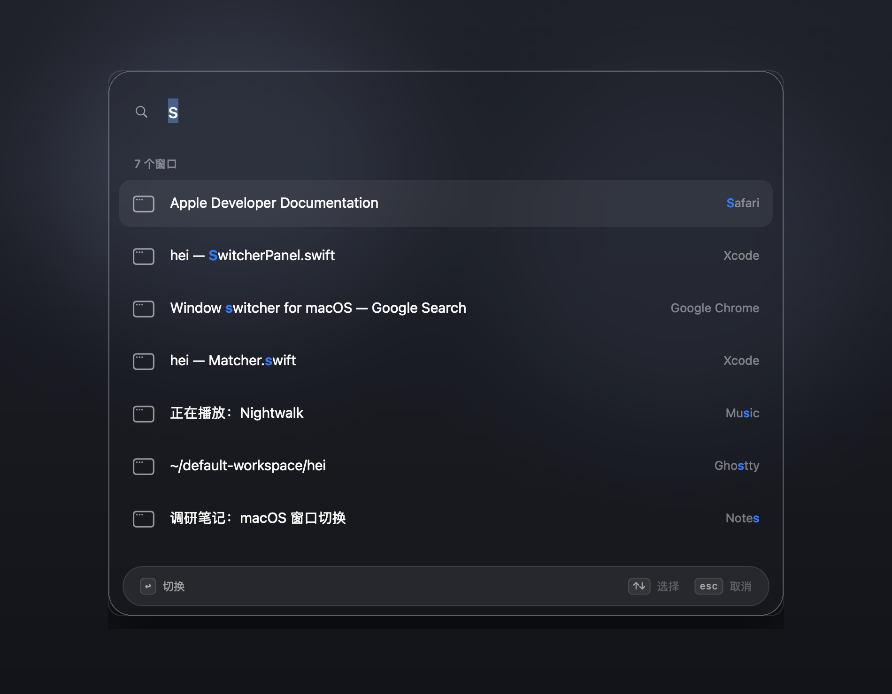

# hei

一个 macOS 窗口级切换器：按 `⇧⌘Space` 弹出搜索框，输入即筛，回车切到**那个窗口**。



## 安装

需要 macOS 13 或更高版本，以及 Xcode 命令行工具。

```bash
cd hei
make build      # 编译出 build/hei.app
make run        # 启动，菜单栏出现图标
```

首次使用要授权：

1. 未授权时启动会自动弹出面板，以及「hei 想要控制这台电脑」。
2. 点「打开系统设置」，在「隐私与安全性 → 辅助功能」里勾选 **hei**。
3. 面板每秒检测一次。开关打开后窗口列表自动出现。

读其他 App 的窗口需要这项权限。

重新编译后，辅助功能里的开关可能还开着，但已经对不上新的程序。先从菜单栏退出 hei，再执行：

```bash
defaults delete com.lvan.hei trustedBuildHash
make run
```

按提示重新勾选 **hei**。

## 使用

| 按键 | 行为 |
|---|---|
| `⇧⌘Space` | 打开 / 关闭切换器 |
| 直接输入 | 按应用名和窗口标题筛选，最佳结果自动选中 |
| `↑` `↓` / `Tab` `⇧Tab` | 移动选择 |
| `↩` | 切到选中窗口。窗口在另一个桌面时，会跟着切过去 |
| `esc` | 关闭，回到原来的 App |
| 鼠标单击某行 | 直接切换 |

不输入时，列表按最近用过的 App、再按窗口前后顺序排列，第一条是上一个活跃窗口。输入 `settings` 或 `设置` 后回车，打开设置。

菜单栏图标 →「设置…」（`⌘,`）：

| 分类 | 内容 |
|---|---|
| 通用 | 开机启动、菜单栏图标、辅助功能权限 |
| 外观 | 跟随系统，或分别选择深色 / 浅色主题 |
| 快捷键 | 唤起快捷键，修改后立即生效 |
| 关于 | 版本、日志（`~/Library/Logs/hei.log`） |

快捷键有四组：`⇧⌘Space`、`⌥Space`、`⌃⌥Space`、`⇧⌘J`。不要用 `⌘Tab`（被 Dock 占用）或 `⌃Space`（输入法切换）。

## 许可

[MIT](LICENSE)。Copyright (c) 2026 lvan。
